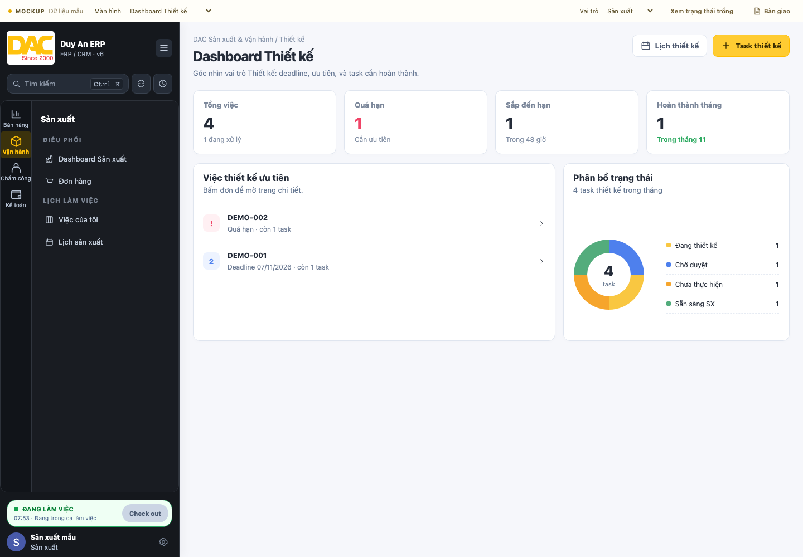

# DAC ERP · Giao diện mockup

Bản bàn giao cho Khang trong repo `VikaKhang286/crm-duyan-v6`: **CL-20261105-010**.
Xem [hướng dẫn nhận bản và triển khai](docs/DELIVERY_TO_KHANG.md).

Duy An chỉnh và duyệt mẫu giao diện tại đây. Khang chuyển mẫu đã duyệt sang
Odoo, kiểm tra nghiệp vụ và deploy production. Các tính năng Duy An code thật
vẫn nằm trong addon tương ứng; thư mục này dành cho thử và duyệt giao diện.



## Mở giao diện

Cần Node.js 20 trở lên. Không cần Odoo, database, token hay `npm install`.

```sh
cd mockup
npm run dev
```

Mở **http://localhost:4173**. Có thể đặt cổng khác bằng `PORT=4174 npm run dev`.
Trang đầu là **Đăng nhập**, sau đó chọn **Quản lý / Sale / Thiết kế / Sản xuất**
để vào dashboard tương ứng. Tài khoản mẫu được điền sẵn:
`demo@duyan.local` / mật khẩu `demo`. Thông tin này chỉ mô phỏng đăng nhập;
không dùng tài khoản production.

Sau khi vào giao diện, có thể đổi vai trò trên thanh MOCKUP hoặc mở biểu tượng
cài đặt cạnh tên người dùng → **Chọn lại vai trò**. Nút **Đăng xuất** đưa về
trang đăng nhập và giữ các dữ liệu mẫu đã chỉnh. Phiên chọn vai trò được nhớ
trong tab hiện tại để tải lại trang vẫn giữ đúng view; mở link gốc luôn hiện
trang đăng nhập.

| Màn hình | Đường dẫn |
| --- | --- |
| Đăng nhập mẫu | `/#login` |
| Chọn vai trò sau đăng nhập | `/#roles` |
| Điều phối CRM / quản lý | `/#manager` |
| Dashboard bán hàng | `/#sales` |
| Dashboard thiết kế | `/#design` |
| Chi tiết task thiết kế | `/#task/T1` |
| Dashboard sản xuất | `/#production` |
| Danh sách đơn | `/#orders` |
| Chi tiết đơn mẫu | `/#order/DEMO-001` |
| Việc của tôi | `/#tasks` |
| Lịch làm việc | `/#calendar` |
| Hội thoại Pancake | `/#conversations` |
| Chấm công | `/#attendance` |
| Thanh toán | `/#payments` |

Tìm/lọc và chọn đơn, tạo/sửa đơn, đổi trạng thái, kéo task, gửi chat mẫu,
ghi chú nội bộ, chuyển tháng lịch và chấm công đều có thể thử. Nút Bàn giao
hiện file Odoo tương ứng và xuất JSON để chia sẻ. Các thao tác lưu trong
localStorage của trình duyệt; vào biểu tượng cài đặt cạnh tên người dùng
để khôi phục dữ liệu mẫu. Phiên mẫu tham chiếu ngày **05/11/2026**.

## Chỉnh sửa và cập nhật phiên mới

| File | Dùng để |
| --- | --- |
| `src/app.js` | Bố cục màn hình và thao tác |
| `src/styles.css` | Màu, font, kích thước, responsive |
| `src/data.js` | Dữ liệu giả và map tới file Odoo |
| `docs/HANDOFF.md` | Yêu cầu đã duyệt và tiêu chí để Khang triển khai |
| `changelogs/README.md` | Danh mục mã changelog và phiên bản mockup để gửi Khang |
| `changelogs/CL-.../` | Changelog chi tiết và bản mockup cố định của từng yêu cầu/phiên |
| `docs/CHANGELOG.md` | Lịch sử thay đổi tóm tắt |
| `docs/CHANGELOG_WORKFLOW.md` | Quy trình tạo mã, chốt bản, ZIP và Git tag |
| `baseline.json` | Dấu vân tay mã Odoo và nguồn đối chiếu giao diện |

Ở phiên mới, có thể yêu cầu: **“Cập nhật lại mockup theo giao diện hiện tại,
giữ các thay đổi tôi đang đề xuất.”** Skill `dac-ui-mockup` trong
`../.agents/skills/dac-ui-mockup/` và `../AGENTS.md` hướng dẫn việc này.
Có thể gọi rõ `$dac-ui-mockup`.

```sh
npm run baseline:check
npm run check
npm run build
```

Khi baseline báo source thay đổi, đối chiếu màn hình bị ảnh hưởng rồi mới
`npm run baseline:update`. Lệnh update ghi nhận source, không tự chuyển XML/OWL
thành mockup hoặc chứng nhận giống production.

## Bàn giao cho Khang

1. Mỗi yêu cầu hoặc phiên chỉnh mới, Codex mở mã `CL-YYYYMMDD-NNN` trong `changelogs/`.
2. Khi Duy An chỉnh xong, Codex viết changelog trước/sau, tiêu chí nghiệm thu
   và chốt đúng phiên bản mockup, kèm ZIP và Git tag `mockup-CL-...`.
3. Duy An gửi ZIP hoặc link changelog của đúng tag cho Khang. Bản cũ được giữ
   nguyên khi phiên tiếp theo tiếp tục chỉnh.
4. Khang tạo nhánh triển khai riêng, dùng map `screens.*.sources` để sửa
   XML/OWL/CSS trong addon và xử lý API, quyền, trạng thái thật.
5. Khang kiểm tra/deploy theo phạm vi được duyệt, ghi commit/PR vào
   `IMPLEMENTATION.md` riêng cạnh changelog; sau đó cập nhật baseline mockup.

Xem [danh mục changelog](changelogs/README.md) và [quy trình chi tiết](docs/CHANGELOG_WORKFLOW.md).
File ZIP được tạo tại `exports/CL-...zip`, gồm tài liệu và mockup chạy độc lập.
Ghi chú trong trình duyệt cần đưa vào changelog trước khi chốt; nút tải JSON
trong Bàn giao chỉ xuất ghi chú, không thay cho gói mockup đã có phiên bản.

HTML/JS mockup không phải Odoo addon có thể chép nguyên vào production.
Thay đổi phân quyền được triển khai và kiểm tra riêng trong Odoo.

## GitHub và xem online

Nhánh mã nguồn: `feat/ui-mockup-workflow` trong repo `VikaKhang286/crm-duyan-v6`.
Git tag bàn giao: `mockup-CL-20261105-010`.
Workflow `DAC Mockup Preview` kiểm tra/build và tạo artifact `dac-mockup-preview`
mỗi khi push thay đổi mockup trên nhánh này. Khang tải artifact trong tab
Actions hoặc chạy local như trên.

Để bật URL GitHub Pages, chủ repo thực hiện một lần:

1. **Settings → Pages → Source: GitHub Actions**.
2. **Settings → Secrets and variables → Actions → Variables**: thêm
   `MOCKUP_PAGES_ENABLED` có giá trị `true`.
3. Trong environment `github-pages`, cho phép deploy từ nhánh mockup;
   chạy lại workflow `DAC Mockup Preview` trên nhánh đó.

GitHub cung cấp URL sau khi job `deploy` thành công. Repo private cần gói GitHub
hỗ trợ Pages; kiểm tra ngay tại Settings của repo. Chỉ dùng dữ liệu giả trong
artifact này. Nếu repo đã dùng Pages cho mục đích khác, không bật workflow
publish này lên cùng site; artifact build vẫn dùng bình thường.
Tham khảo [hướng dẫn cấu hình Pages của GitHub](https://docs.github.com/en/pages/getting-started-with-github-pages/configuring-a-publishing-source-for-your-github-pages-site).

## Dashboard nhân viên Thiết kế

Bản [CL-20261105-002](changelogs/CL-20261105-002/CHANGELOG.md) đổi dashboard
thành danh sách task, có tên công việc, mã đơn, khách hàng, trạng thái và hạn.
Bấm task để xem mô tả chi tiết trước, thông tin đơn hàng và thông số sản phẩm
bên dưới. Danh sách/chi tiết đơn của vai trò Thiết kế không hiện giá tiền.
Luồng từ Việc của tôi và Lịch thiết kế cũng mở chi tiết task này.

Bản [CL-20261105-003](changelogs/CL-20261105-003/CHANGELOG.md) bổ sung:

- Đổi nhãn thành **Mô tả thiết kế**, đặt thông tin đơn và các dòng sản phẩm ở cuối trang.
- Thiết kế gửi bình luận/ảnh preview và bấm **Hoàn thành task**, không chọn trạng thái bằng dropdown.
- Sale vào đơn hàng → bấm tên task để xem ảnh, góp ý hoặc duyệt. Gửi góp ý tự chuyển task sang **Cần chỉnh sửa**, xuất hiện trong mục riêng trên dashboard Thiết kế.
- Sau khi chỉnh sửa, Thiết kế gửi preview mới và bấm hoàn thành lần nữa. Sale duyệt mới mở phần gửi file thiết kế chính thức.
- Tất cả thao tác, ảnh và file chỉ lưu ở trình duyệt này để duyệt mockup; không gửi cho tài khoản khác. File demo tối đa 1 MB mỗi file.

Bản [CL-20261105-004](changelogs/CL-20261105-004/CHANGELOG.md) làm gọn màn Thiết kế:

- Danh sách task chia hai cột trên máy tính. Chi tiết task có mô tả/file bên trái, chat bên phải; thông tin đơn và sản phẩm ở dưới.
- Trong chat, bấm icon kẹp giấy hoặc Ctrl/Cmd+V để dán ảnh. Ảnh nằm ở bản nháp trước khi gửi; Enter gửi, Shift+Enter xuống dòng.
- Nút **Copy ảnh** trên mỗi preview sao chép ảnh vào clipboard để Sale dán gửi khách hàng. Nếu trình duyệt không cho phép clipboard, mở ảnh để sao chép thủ công.
- File được gửi sau duyệt hiển thị ở **File thiết kế đã bàn giao** trên dashboard/trang đơn Sản xuất. Có nút xem và tải bản gốc; chỉ hiển thị file của bản thiết kế đang được duyệt.
- Chọn vai trò **Sản xuất** để thử luồng nhận file của quản lý sản xuất trong mockup. Task decal DEMO-006 có file vector giả bàn giao sẵn nếu dùng bộ dữ liệu mẫu mới.

Phạm vi bản này ưu tiên giao diện Thiết kế và nối luồng nhận file. Giao diện chat/task
Sản xuất theo cùng mẫu được ghi nhận để thực hiện sau khi Duy An duyệt màn Thiết kế.

Bản [CL-20261105-005](changelogs/CL-20261105-005/CHANGELOG.md) đổi nút thành
**Thiết kế xong**: gửi ảnh preview rồi bấm nút để chờ Sale duyệt. Task đã duyệt,
kể cả đã gửi file, có nút **Chỉnh sửa tiếp**. Nút này mở vòng sửa mới, giữ lịch sử
preview/file; gửi preview mới → Thiết kế xong → Sale duyệt → bàn giao file mới.
File cũ thành phiên bản trước, Sản xuất nhận file của vòng mới sau khi duyệt/bàn giao.

Bản [CL-20261105-006](changelogs/CL-20261105-006/CHANGELOG.md) dành sidebar riêng
cho nhân viên Thiết kế: **Tổng quan, Lịch thiết kế, Đơn hàng được giao, Chấm công**.
Sidebar rộng 230px, bỏ thanh ứng dụng ngoài cùng và các mục Kế toán/Bán hàng/Sản xuất.
Cài đặt cá nhân, đăng xuất và trạng thái chấm công nằm cuối sidebar.

**Tổng quan** gồm thống kê số đơn và task thiết kế, mục cần chỉnh sửa và danh sách
task hai cột. Bấm bất kỳ ô thống kê nào sẽ lọc và cuộn tới danh sách tương ứng,
hiện tên nhóm đang xem; ô có số 0 vẫn mở danh sách rỗng rõ ràng. **Đơn thiết kế**
đếm số mã đơn khác nhau trong tập task được giao; các ô trạng thái đếm task và
ghi kèm số đơn. Một đơn có nhiều task chỉ được tính một lần trong tổng đơn.

Trong dữ liệu mẫu, nhân viên đang xem là `Thiết kế mẫu`; danh sách task/đơn/lịch
lọc theo người được giao mẫu. Đây là mô phỏng bố cục và phạm vi dữ liệu, không
thay thế phân quyền/record rules trong Odoo.

Bản [CL-20261105-007](changelogs/CL-20261105-007/CHANGELOG.md) đặt tên task theo
**Thiết kế + Tên khách + DD/MM**, ví dụ **Thiết kế Khách hàng mẫu 01 05/11**.
Ngày dùng ngày tạo task; mockup cũ thiếu ngày này tham chiếu ngày tạo trong
fixtures hoặc ngày đơn hàng. Tên hiển thị thống nhất trên Tổng quan, task, lịch,
đơn và dữ liệu ghi chú xuất ra; mở sửa tiếp không đổi ngày trong tên.

Bản [CL-20261105-008](changelogs/CL-20261105-008/CHANGELOG.md) đổi Tổng quan
thành hai cột: **Cần làm** bên trái (bao gồm task cần chỉnh sửa), **Thông báo**
bên phải. Các ô thống kê vẫn lọc danh sách trái; trang mặc định mở nhóm Cần làm.

Thông báo có tin nhắn/duyệt từ Sale, đơn mới được giao và task quá hạn. Người gửi
có avatar mẫu bằng chữ viết tắt; hệ thống/cảnh báo có icon. Tên người và task in
đậm, tên task tối đa 20 ký tự gồm dấu `...`, nội dung tối đa 3 dòng và cắt ở đoạn
tin nhắn. Từ bản CL-20261105-010, thời gian tương đối nằm cùng dòng ở cuối nội dung.
Bấm thông báo mở đúng task hoặc đơn.

**Nút chuông trong ERP** mở bảng thông báo trên các màn Thiết kế, dùng chung
trạng thái đọc với cột bên phải. Có lọc Tất cả/Chưa đọc, đánh dấu tất cả đã đọc,
đóng bằng Escape hoặc bấm ra ngoài. Phần mở rộng được tách trong
`src/notifications.js` để dùng chung; không cần cài tiện ích Chrome.

Trao đổi và đơn mới thao tác trong mockup sẽ tạo thông báo khi quay lại vai trò
Thiết kế trong cùng trình duyệt. Mẫu mới có task cần chỉnh sửa và trao đổi sẵn để
duyệt bố cục. Dữ liệu trình duyệt cũ được giữ, không chèn đè các trao đổi mẫu.

Bản [CL-20261105-009](changelogs/CL-20261105-009/CHANGELOG.md) thu gọn thẻ
trong Cần làm: tên task, mã đơn/sản phẩm và một hàng nhãn trạng thái + hạn DD/MM.
Bỏ dòng tên khách lặp lại và các nhãn riêng lẻ trùng nhau. Mỗi thẻ chỉ có một
nhãn; khi quá hạn thì ưu tiên Quá hạn, trạng thái gốc xem trong task/tooltip.
Việc gom nhãn không đổi trạng thái dữ liệu hoặc cách lọc theo các ô thống kê.

Bản [CL-20261105-010](changelogs/CL-20261105-010/CHANGELOG.md) đặt thời gian
ngay sau nội dung, ví dụ `… · 5 phút`, trên cả cột Thông báo và bảng chuông.
Toàn bộ nội dung kèm thời gian vẫn tối đa 3 dòng; cắt ngắn tin nhắn nếu cần
để thời gian luôn nhìn thấy, không dành riêng một hàng thời gian.

## Nguồn và phạm vi đối chiếu

Khung sidebar và Dashboard Thiết kế đã đối chiếu trực tiếp production ngày
05/11/2026, desktop 1440×1000 trong phiên dựng nền. Dashboard và chi tiết task
Thiết kế hiện tại là các đề xuất CL-20261105-002 đến CL-20261105-010, chưa triển khai production.
Phiên này đối chiếu lại ảnh dashboard production lưu ngày 04/11 và mã nguồn
Odoo tại checkout; không đăng nhập lại production. Trang đơn, sản xuất và task tham chiếu ảnh
production ngày 04/11 trong workspace cùng mã XML/CSS; những màn hình còn lại
dựng theo mã đang có trong checkout. Đây là bản tái dựng có thể chỉnh sửa;
chưa phải bản sao pixel hoàn chỉnh của mọi màn hình production.

Mobile giữ nhận diện, có menu mở/đóng và cuộn bảng, đồng thời thu KPI thành
2 cột. Đây là điều chỉnh bố cục có ghi trong HANDOFF, chưa phải thay đổi đã
được triển khai production. Không đưa ảnh khách hàng hoặc credential vào repo.
